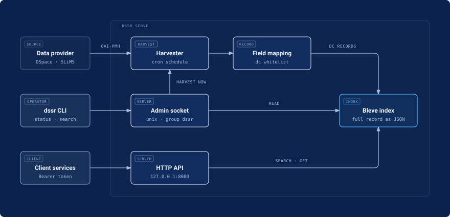

# dssr

dssr harvests metadata from any OAI-PMH data provider, keeps its own search index, and serves search over an HTTP API.
Client services search dssr, so they do not need access to the source systems.
dssr only reads the OAI-PMH endpoint of each source.
dssr maps two metadata formats: `oai_dc`, which every OAI-PMH data provider supplies, and `dim`, which DSpace supplies.
`oai_dc` is the default.
`dim` gives more detail for DSpace, for example the role of each contributor.



> [!WARNING]
> dssr is experimental. Do not use it in production. The API, configuration, and index format may change without notice.

## Relationship to VuFind

dssr solves the problem that [VuFind](https://github.com/vufind-org/vufind) solves: pull records into a local search index, then answer discovery queries without asking the source on each request.
It is not a VuFind replacement.
VuFind is a PHP portal with a user interface, Solr, ILS drivers, and a separate OAI-PMH harvester.
dssr is a headless service with an embedded index, and its HTTP API is its only interface, so it has no user interface and no ILS driver layer.
dssr works with any source and relies only on published contracts: OAI-PMH 2.0 for harvesting, `dim` and `oai_dc` mapped through a `dc` field whitelist, and OpenAPI 3.1 for the HTTP API.

## Requirements

| Resource | Minimum                         |
| -------- | ------------------------------- |
| CPU      | 1 core, `x86_64` (`amd64`) only |
| Memory   | 512 MB                          |
| Disk     | 1 GB free under `/var/lib/dssr` |

## Install

On a Linux server with systemd, run this command:

```bash
curl -fsSL https://kuueri.com/dssr/install.sh | sudo bash
```

The script does these steps:

1. It downloads the latest release for `amd64` and checks the SHA-256 checksum. On a host with glibc, it uses the glibc build if that build runs there; otherwise it uses the static musl build, which runs on every Linux host.
2. It installs `/usr/local/bin/dssr` and the systemd service `dssr`.
3. It makes the system user `dssr` and adds the user that runs `sudo` to the group `dssr`.
4. If `/etc/dssr/dssr.yaml` does not exist, it writes the file with a new client token and an example source in comments.
5. It starts dssr. dssr harvests nothing until the file has a source.

After the install, add each source under `sources` in `/etc/dssr/dssr.yaml` and restart dssr, as [Configure](#configure) describes.
The first harvest of a source reads all its records.
Run `dssr doctor` to check the installation and see the fix for each problem.

When the script writes the file, it shows the client token one time.
dssr keeps only the hash of the token, so store the token immediately, or make a new one later with `sudo dssr revoke`.

To install a specific release, add `DSSR_VERSION=0.1.0` after `sudo`.

dssr listens on `127.0.0.1:8080` and does not use TLS.
Put a TLS reverse proxy in front of dssr before other hosts use the API.

## Configure

Edit `/etc/dssr/dssr.yaml`, then restart dssr with `sudo systemctl restart dssr`.
dssr does not start if the file has an unknown key or an incorrect value.

| Key            | Value                                                                                                                                                                                                            |
| -------------- | ---------------------------------------------------------------------------------------------------------------------------------------------------------------------------------------------------------------- |
| `listen`       | TCP address of the HTTP API                                                                                                                                                                                      |
| `index_path`   | Directory of the index                                                                                                                                                                                           |
| `admin_socket` | Path of the unix socket for the `dssr` subcommands                                                                                                                                                               |
| `timezone`     | Time zone for the schedules                                                                                                                                                                                      |
| `clients`      | `name` and `token_sha256` of each client service                                                                                                                                                                 |
| `sources`      | `id`, `name`, `oai_url`, `metadata_prefix` (`oai_dc` by default, or `dim`), and `schedule` (cron expression) of each source                                                                                      |
| `search_log`   | `output` (`stdout` or an absolute file path), `hits` (results kept per search, 10 by default), and `max_size_mb` (file size that starts a rotation, 64 by default); without this key, dssr does not log searches |

To replace the client token, for example when it is lost or leaked, run:

```bash
sudo dssr revoke
```

It writes the hash of a new `sk-` token to the client `default`, restarts dssr, and shows the token one time.
The previous token stops working.
Give the token to the client service, which sends it in the header `Authorization: Bearer <token>`.

## Update

Run this command as root:

```bash
sudo dssr update
```

It installs the latest release if that release is newer than the installed version.
To install a specific newer release, for example a pre-release, set `DSSR_VERSION`:

```bash
sudo DSSR_VERSION=0.1.0 dssr update
```

dssr runs `install.sh` from the tag of the release, not from `main`, so the script and the release files have the same version.
The update keeps `/etc/dssr/dssr.yaml` and restarts dssr.

## Reindex

When the release notes say that a release changes the index, run this command as root after the update:

```bash
sudo dssr reindex
```

It stops dssr, deletes the index at `index_path`, and starts dssr, which then harvests every record of each source again.
Search results stay incomplete until each harvest ends, so run it only when every source answers OAI-PMH.

## Remove a source

To delete one source and all its records, run this command as root:

```bash
sudo dssr remove <id>
```

It stops dssr, removes the source from `/etc/dssr/dssr.yaml`, deletes its records, cursor, and suspension from the index, and starts dssr again.
If the source is no longer in the configuration, it deletes only the records and state in the index.
The command does not start while a harvest runs, because the restart would stop it.
The restart starts the startup harvest of every other source.
You cannot undo this command. To harvest the source again, add it to `/etc/dssr/dssr.yaml` and restart dssr.

## Uninstall

Run this command as root:

```bash
sudo dssr uninstall
```

It stops and disables the service, then removes the systemd unit, `/usr/local/bin/dssr`, `/usr/local/share/doc/dssr`, `/etc/dssr`, `/var/lib/dssr`, the search log at `/var/log/dssr`, the index at `index_path`, the socket at `admin_socket`, and the `dssr` user and group, including the user's mail spool.
It deletes every harvested record, so the action cannot be undone.
If a step fails, it keeps `/usr/local/bin/dssr`, so you can correct the cause and run the command again.
The system journal keeps the old `dssr` entries, because journald has no per-unit deletion.

## Use

On the server, run the `dssr` subcommands as root or as a member of the group `dssr`.
The install script adds the user that runs `sudo` to the group, so log in again after the first install.
To add another user, run `sudo usermod -aG dssr <user>`.
The subcommands read `/etc/dssr/dssr.yaml`, and `--config` selects a different file.

```bash
dssr status
dssr search "wisata ziarah" --year 2020-2024
dssr get repo:123456789/56
dssr harvest --full
```

| Command                               | Action                                                                     |
| ------------------------------------- | -------------------------------------------------------------------------- |
| `dssr status`                         | Show the record count, cursor, last run, and dropped fields of each source |
| `dssr doctor`                         | Check the installation and show the fix for each problem                   |
| `dssr search <query>`                 | Search with the same logic as the HTTP API                                 |
| `dssr get <id>`                       | Show one record                                                            |
| `dssr harvest [--source ID] [--full]` | Start a harvest now                                                        |
| `dssr cancel [--source ID]`           | Stop the running harvest; the cursor stays where it was                    |
| `dssr suspend [--source ID]`          | Skip the scheduled and startup harvests until `dssr resume`                |
| `dssr resume [--source ID]`           | Start the schedule again                                                   |
| `dssr eval <file>`                    | Measure search relevance with a list of queries                            |

Run `dssr <command> --help` to see the options of a command.

Client services use the HTTP API with a bearer token:

```bash
curl -H "Authorization: Bearer $TOKEN" "http://127.0.0.1:8080/v1/search?q=wisata+ziarah&limit=5"
```

| Endpoint                            | Purpose                                     |
| ----------------------------------- | ------------------------------------------- |
| `GET /v1/search`                    | Search with filters, highlights, and facets |
| `GET /v1/records/{source}/{handle}` | Get one record                              |
| `GET /openapi.json`                 | Full API description, without a token       |
| `GET /healthz`                      | Liveness check, without a token             |

## Search log

dssr does not log searches until `search_log` is in `dssr.yaml`.
It logs only `/v1/search` requests, one JSON line each, with the client name and no IP address or token.

With `output: stdout`, read the lines with:

```bash
journalctl -u dssr -o cat --no-pager | jq -c 'select(.msg == "search")'
```

With a file, use `/var/log/dssr/search.log`, because the service can write only under `/var/lib/dssr` and `/var/log/dssr`.
The file rotates to `search.log.01`, then `search.log.02`, and so on, when it reaches `max_size_mb`.
dssr does not delete old rotated files, so remove them yourself or manage them with logrotate.
A line with `dropped` means dssr skipped that many searches because the disk was too slow.

Queries without results:

```bash
jq -c 'select(.msg == "search" and .total == 0) | {q, filter}' /var/log/dssr/search.log
```

To make an eval case from a line, keep `q` and `filter`, add `expect` with the IDs of the records the query must find, and add the item to the YAML file for `dssr eval`.

## Important behavior

- Data in dssr is only as fresh as the OAI-PMH data of the source. Set `schedule` to run after the source refreshes its OAI-PMH data.
- An incremental harvest cannot find records that a source deleted without a deletion record, for example items that DSpace expunged. Run `dssr harvest --full` to delete them from the index.
- A full harvest does not delete old records if it sees fewer than 90% of the indexed records. This guard keeps the index if the source fails.
- For a source whose OAI-PMH datestamp does not change when a record changes, for example SLiMS, an incremental harvest finds only new records. Run `dssr harvest --full` to get the changes.
- After a change to `metadata_prefix`, run `dssr harvest --full --source ID`, because the index keeps the records of the old format until each record is harvested again.
- `dssr status` shows the fields that dssr dropped. Use this list to extend the field mapping in `src/record.rs`.
- The index keeps the schema and the analyzer from the time dssr made it. After a change to `src/index`, run `sudo dssr reindex`.

## Development

dssr builds and runs on Linux.

| Requirement                                                           | Needed for                                                       |
| --------------------------------------------------------------------- | ---------------------------------------------------------------- |
| Stable Rust 1.90 or later through rustup, with `rustfmt` and `clippy` | Building, testing, and linting; nightly features are not allowed |
| `shellcheck`                                                          | Checking `install.sh` and `scripts/package.sh`                   |
| The rustup target `x86_64-unknown-linux-musl`                         | The static musl release binary                                   |
| `musl-gcc` (Fedora `musl-gcc`, Debian and Ubuntu `musl-tools`)        | Compiling the C code of `ring` for the musl release binary       |
| `jq`                                                                  | Collecting the dependency licenses in `scripts/package.sh`       |

The tests start their own OAI-PMH and HTTP servers on `127.0.0.1` and need no network access.
Run every check before a change is done:

```bash
cargo fmt --check
cargo clippy --all-targets -- -D warnings
cargo test
shellcheck install.sh scripts/package.sh
```

To run dssr locally, copy `dssr.example.yaml` to `dssr.yaml`, set a source, and start it:

```bash
cargo build --release
target/release/dssr serve --config dssr.yaml
target/release/dssr status --config dssr.yaml
```

`dssr.yaml`, the index under `data/`, and the socket stay out of git.
`bash scripts/package.sh X.Y.Z` builds the two release archives in `dist/`, `dssr_linux_amd64.tar.gz` (static musl) and `dssr_linux_amd64_gnu.tar.gz` (glibc of the build host), and it needs a `CHANGELOG.md` section for `X.Y.Z`.

## License

dssr is licensed under the [Apache License 2.0](LICENSE).
